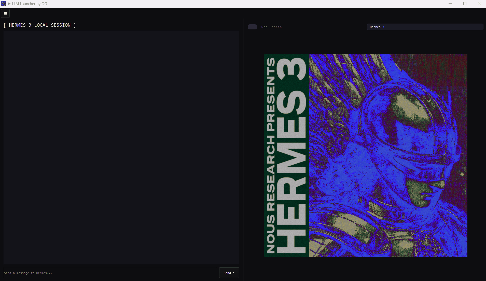
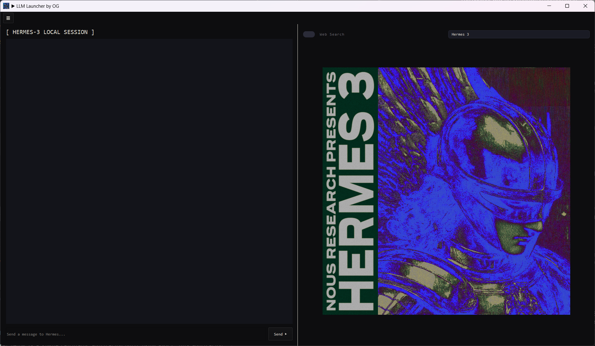
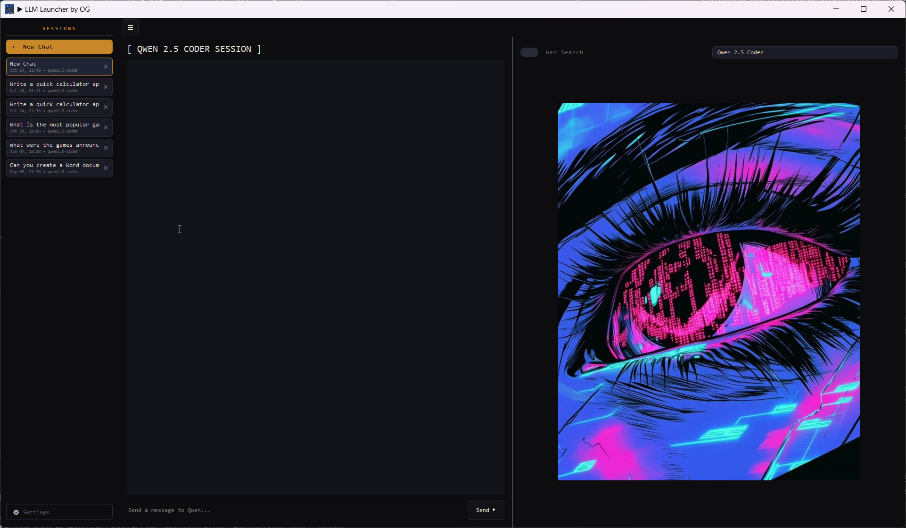

## LLM Launcher
A local AI chat desktop app for Windows, built with PyQt5 and powered by Ollama. Everything runs on your own machine - no cloud APIs, no accounts.

It ships with 2 models you can switch beween from a dropdown:
```bash
  MODEL    |   BEST FOR
-------------------------------------------------
HERMES3 8b |  General conversation, web assisted answers
Qwen2.5    |  Coding, creating and
Coder 14b  |  editing files on your desktop
```

## Features
- Dark, themed UI - collapsible sessions sidebar, chat panel and a model panel with the active model's logo
- Chat sessions - each coversation is saved as a session,
titled automatically from your first message and filtered by model in the sidebar
- Persistent history - sessions are stored in sessions.json and survive app restarts
- Web search toggle - uses DuckDuckGo (general results, Reddit, recent news, plus Stack Overflow and GitHub for coding queries)

` - Hermes 3 decides when to search through Ollama tool calling`

`- Qwen receives search results up front with your question`
- Desktop file tools (Qwen) - on explicit request, Qwen can create, read, list, and delete files on your Desktop, including `.docx` and `.xlsx`
- Code self-review -when a reply contains code, the model gets a second pass to check and fix it before it is shown.
- Per-model context length - adjustable from 4k to 64K tokens in Settings, saved to `settings.json`
- Markdown code blocks - rendered with preserved indentation





## Requirements
- Windows 10/11
- Python 3.10+
- Ollama installed and running
- A GPU strong enough to run 14B models

## Installation
1. Clone the repo:
```bash
git clone https://github.com/JonathanMovement/LLM_Launcher.git
cd Hermes3_LLM
```
2. Create and activate a virtual environment:
```bash
python -m venv venv
venv\Scripts\activate
```
3. Install the dependences:
```bash
pip install -r requirements.txt
```
4. Pull the models:
```bash
ollama pull hermes3
ollama pull qwen2.5-coder:14b
```
## Usage
Make sure Ollama is running (it listens on `http://localhost:11434`), then start the app:
```bash
python MainLocal_LLM.py
```

## Building the .exe
The project includes a PyInstaller spec file:
```bash
pip install pyinstaller
pyinstaller "LLM Launcher.spec"
```
The executable is created in `dist/LLM Launcher/`. Ollama and the models still need to be installed on the target machine.

## Tech stack
`Python · PyQt5 · Ollama · DuckDuckGo Search (ddgs) · python-docx · openpyxl · PyInstaller`

## For more info, check `ClassSyntax.txt`
